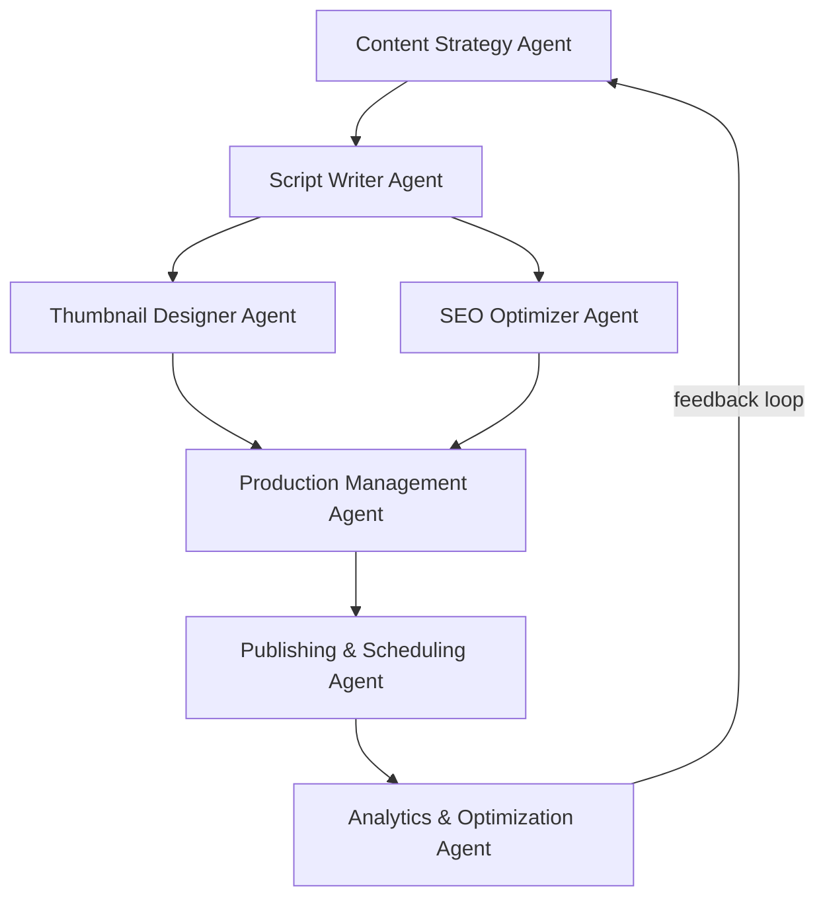

# YouTube Automation System, "What If You Lived As..."

Fully documented multi-agent pipeline for producing immersive, second-person "live a lifetime in 8 minutes" videos. Built to be executed by Claude Code / Palmier Pro: every agent is an md spec, every deliverable has a template, every episode lives in its own folder.

## Pipeline



## Folder structure

```
youtube-automation/
├── README.md                 ← you are here
├── CLAUDE.md                 ← operating instructions for Claude Code / Palmier Pro
├── agents/
│   ├── 01-content-strategy.md
│   ├── 02-script-writer.md
│   ├── 03-thumbnail-designer.md
│   ├── 04-seo-optimizer.md
│   ├── 05-production-management.md
│   ├── 06-publishing-scheduling.md
│   └── 07-analytics-optimization.md
├── pipeline/
│   └── PIPELINE.md            ← handoff contracts between agents
├── niche/
│   └── NICHE.md               ← the "What If You Lived As..." format bible
├── templates/
│   ├── SCRIPT_TEMPLATE.md
│   ├── MASTER_IMAGE_PROMPT.md
│   ├── SEO_TEMPLATE.md
│   ├── THUMBNAIL_BRIEF.md
│   ├── ELEVENLABS_GUIDE.md
│   └── PUBLISHING_CHECKLIST.md
└── videos/
    └── ep001-octopus/
        ├── STATUS.md          ← per-episode pipeline tracker
        ├── 00_ANGLES.md       ← 5 curiosity-gap angles (Content Strategy output)
        ├── 01_SCRIPT.md       ← full timestamped script (Script Writer output)
        ├── 02_IMAGE_PROMPTS.md← one image prompt per timestamp
        ├── 03_SEO.md          ← title/description/tags (SEO Optimizer output)
        └── 04_THUMBNAIL.md    ← thumbnail brief (Thumbnail Designer output)
```

## How to produce a new episode

1. Copy `videos/ep001-octopus/STATUS.md` into a new folder `videos/epNNN-slug/`.
2. Run agent 01 (`agents/01-content-strategy.md`) → produces `00_ANGLES.md`. Pick one angle.
3. Run agent 02 → `01_SCRIPT.md` + `02_IMAGE_PROMPTS.md`.
4. Run agents 03 and 04 in parallel → `04_THUMBNAIL.md`, `03_SEO.md`.
5. Run agent 05: generate VO in ElevenLabs (`templates/ELEVENLABS_GUIDE.md`), generate all images, assemble edit.
6. Run agent 06: publish per `templates/PUBLISHING_CHECKLIST.md`.
7. After 48h and 7d, run agent 07 and write findings back into `niche/NICHE.md` and the agent files. That closes the feedback loop.

## Rules that never change

- Second person, always. The viewer never leaves the role.
- Hook lands inside the first 8 seconds. No "hey guys."
- One idea per line. Spoken cadence.
- A new curiosity loop opens every 60 to 90 seconds; every loop pays off.
- Dark, immersive, slightly eerie. End on one clean takeaway.
- One image per timestamp. No skipped timestamps.
