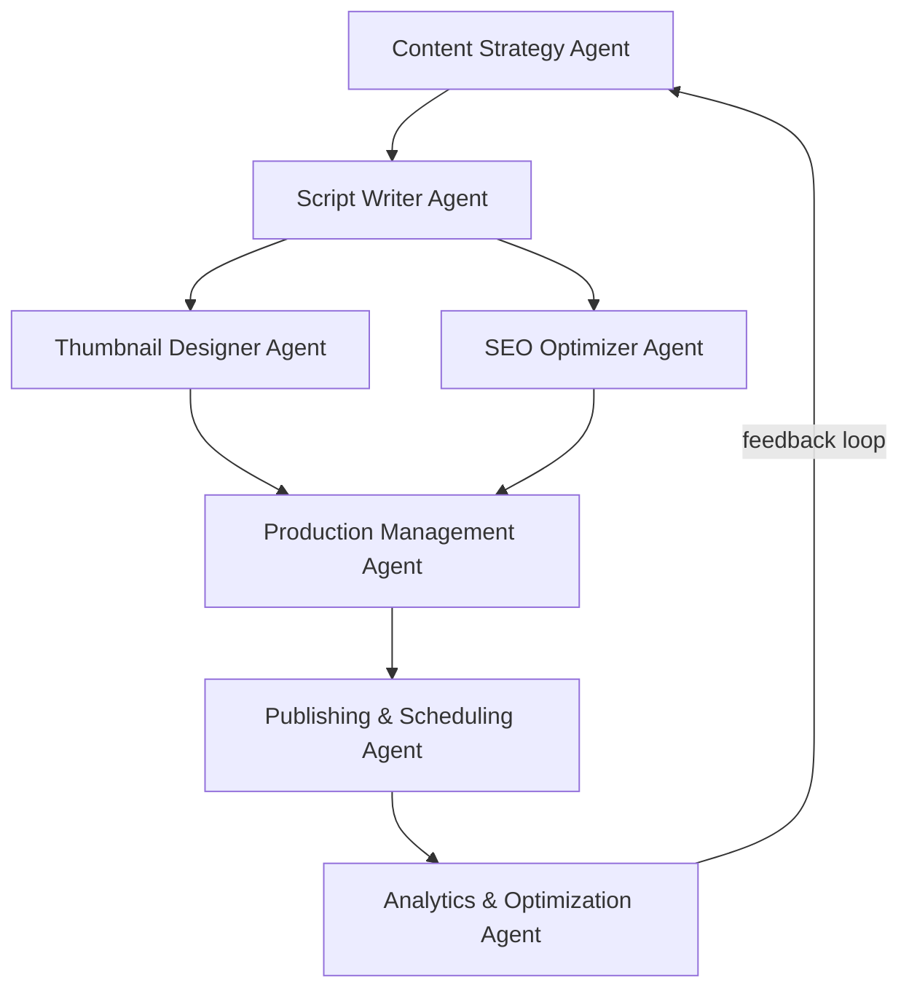

# PIPELINE.md, Agent Handoff Contracts

Each row below is a contract: the producing agent must deliver exactly the "Output file" in the exact template, or the next agent rejects it.

| # | Agent | Reads | Output file | Template | Human gate |
|---|-------|-------|-------------|----------|------------|
| 01 | Content Strategy | NICHE.md, analytics learnings | `00_ANGLES.md` | 5 curiosity-gap titles | Pick 1 angle |
| 02 | Script Writer | chosen angle, NICHE.md | `01_SCRIPT.md` + `02_IMAGE_PROMPTS.md` | SCRIPT_TEMPLATE + MASTER_IMAGE_PROMPT | Approve script |
| 03 | Thumbnail Designer | `01_SCRIPT.md` | `04_THUMBNAIL.md` | THUMBNAIL_BRIEF |, |
| 04 | SEO Optimizer | `01_SCRIPT.md`, angle | `03_SEO.md` | SEO_TEMPLATE |, |
| 05 | Production Mgmt | script, image prompts, SEO, thumbnail | rendered assets + `edit.md` | ELEVENLABS_GUIDE |, |
| 06 | Publishing | all assets, `03_SEO.md`, thumbnail | published video + schedule | PUBLISHING_CHECKLIST | Final check |
| 07 | Analytics | YouTube Studio data | learnings appended to agent 07 + NICHE.md |, |, |

## Contract details

**01 → 02:** Angle handoff is a single line: the exact chosen title + a one-sentence promise of the curiosity gap. Nothing else carries forward.

**02 → 03 & 04 (parallel):** Script Writer must emit timestamps in `[MM:SS]` form. Image prompts file must have the same number of entries as timestamps, this is verified programmatically (see agent 05).

**03/04 → 05:** Production only starts when script is human-approved AND both thumbnail brief + SEO exist.

**05 → 06:** Production emits final MP4 + thumbnail PNG + the SEO block ready to paste.

**06 → 07:** Publishing records publish datetime so analytics knows the 48h / 7d windows.

**07 → 01 (feedback loop):** Analytics writes 3 things every cycle: what to keep, what to cut, next-episode angle nudge. Content Strategy must read the latest learnings before generating new angles.
