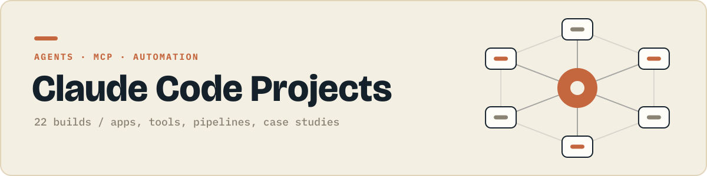

# Claude Code projects

Everything I've built with Claude Code: automations, apps, tools, client work and the skills and agents I made along the way. I come up with the idea, make the calls and give the feedback. Claude Code does most of the building. Every project here is real and most of them I use every week.

## How I use Claude Code

- **MCP servers**: Palmier Pro (video editing), ElevenLabs (voice and music), Figma (design writes through the plugin API), Playwright and Claude in Chrome (browser testing and research), Gmail, Google Calendar, Supabase.
- **Subagents and multi agent workflows**: solver and auditor pairs, blind judges, independent checkers that redo the maths.
- **Custom skills and agents**: an adversarial deck reviewer, a footage scout, a reels editor, a file tidy skill.
- **LLM council**: 5 advisors who argue and peer review each other before I commit to anything big. Several projects here changed direction because of it.
- **Automation around it**: launchd jobs, scheduled cloud routines, hooks, and an Obsidian second brain Claude writes to after every session so context carries over.
- **Verify, don't trust**: rendered output gets rasterised and looked at, numbers get re derived, evaluations get benchmarked against something real first.

## Projects

| # | Project | What it shows | Type |
|---|---|---|---|
| [01](./01-youtube-what-if-you-lived-as) | **What If You Lived As (YouTube)** | 7 agent faceless YouTube channel, Palmier Pro + ElevenLabs MCPs, fal.ai | automation |
| [02](./02-clipforge) | **ClipForge** | Shorts pipeline, reframed by an LLM council before any code | automation |
| [03](./03-maths-explainer-videos) | **Maths Explainer Videos** | Manim explainers scored blind against 3Blue1Brown | automation |
| [04](./04-autodj) | **autodj** | Claude plans the DJ set, a DSP engine mixes it, a judge checks it | audio |
| [05](./05-study-desk) | **Study Desk** | Canvas to Todoist to study guides, with a dead man's switch | tool |
| [06](./06-canvas-pa) | **Canvas PA** | Study assistant built around starting, not remembering | tool |
| [07](./07-money-tracker) | **Money** | Spending priced in days, live 'can I?' answer | tool |
| [08](./08-homesound) | **homesound** | Two Bluetooth speakers in sync at 7.4 ms for free | audio |
| [09](./09-filmcam) | **FilmCam** | iOS film camera, 15 looks, numpy look lab | app |
| [10](./10-ibcompass) | **IBCompass** | IB guidance SaaS, schema validated LLM output | app |
| [11](./11-clutchup) | **ClutchUp** | Manual driving curriculum on real Pune roads | app |
| [12](./12-weekly-tidy) | **Weekly Tidy** | Sunday file tidy with a Claude skill to finish it | tool |
| [13](./13-skills-and-agents) | **Skills And Agents** | The Council, footage scout, reels editor skill | claude code |
| [14](./14-wardrobe-catalogue) | **Wardrobe Catalogue** | 48 photos to a typed, branded inventory with vision | life admin |
| [15](./15-party-invite) | **Party Invite** | Cinematic animated web invite | design |
| [16](./16-trip-and-weekend-guides) | **Trip And Weekend Guides** | Researched trip boards for friends | research |
| [17](./17-clinic-content-engine) | **Clinic Content Engine** | n8n + Figma + a model free safety guard | client, case study |
| [18](./18-clinic-brand-and-website) | **Clinic Brand And Website** | 30 template Figma library and handover package | client, case study |
| [19](./19-pitch-deck-adversarial-review) | **Pitch Deck Adversarial Review** | 4 deck versions, bugs caught by council review | client, case study |
| [20](./20-academy-fee-system) | **Academy Fee System** | 468 column Excel audit, triple checked by agents | client, case study |
| [21](./21-sponsorship-programme) | **Sponsorship Programme** | Deck and rate card generated from one rates file | client, case study |
| [22](./22-multi-agent-study-pdfs) | **Multi Agent Study PDFs** | 10 agent solve and audit workflow | multi agent |

Client work is anonymised and documented as case studies with no code or files. Secrets, personal data, copyrighted media and client assets are left out everywhere.

## Learning

[WANT-TO-LEARN.md](./WANT-TO-LEARN.md) is my running list of what I want to learn next.
